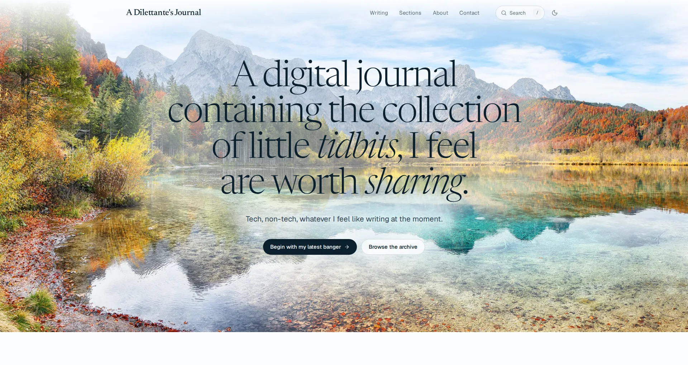

# A Dilettante's Journal

[](https://blog.romitraj.dev/)

**Live site:** [blog.romitraj.dev](https://blog.romitraj.dev)

A personal blog for whatever I feel like writing at the moment. Built with Astro, self-hosted on my own server, edited through a custom Keystatic CMS setup.

## What this is

A static Astro blog with a Git-based CMS wired to match the site's content conventions, self-hosted comments and analytics, and automatic deployment on push.

## Stack

- **Astro**, static site generation, MDX content
- **Quiet Pages 3**, the theme it is built on
- **Tailwind CSS**
- **Keystatic**, Git-based CMS
- **GitHub Actions**, syncs post tags/categories automatically
- **Remark42**, self-hosted comments
- **Rybbit**, self-hosted analytics
- **Dokploy**, self-hosted deployment
- **Vite+** and **Playwright**, the checks and tests

## Getting Started

You need [Node.js](https://nodejs.org) 26 and [pnpm](https://pnpm.io). [Vite+](https://viteplus.dev) (`vp`) brings both.

Install dependencies:

```bash
pnpm install
```

Start the development server:

```bash
pnpm dev
```

Build for production:

```bash
pnpm build
```

Preview the production build locally:

```bash
pnpm start
```

Check and test it:

```bash
pnpm run lint      # formatting, lint and type checks (vp check, astro check)
pnpm test          # unit tests (vp test)
pnpm run smoke     # builds it, then opens every page in Chromium and tests Keystatic
pnpm run test:browsers   # the same in Chromium, Firefox and WebKit
```

Playwright, which opens the browsers, does not support Fedora. On Fedora, run the last two inside the Ubuntu toolbox: `toolbox run -c playwright bash -lc 'cd "<this folder>" && pnpm run smoke'`.

## Content

Blog posts live in `src/content/blog`. Each post is an `index.mdx` file inside its own folder, with local images stored beside the content.

Required frontmatter: `title`, `excerpt`, `date`, `category`, `tags`, `author`, `thumbnail`, `thumbnailAlt`

`category` and `tags` must be listed in `src/config/taxonomy.ts` (the taxonomy sync below adds new ones by itself), and `author` in `src/config/authors.ts`.

Posts can be edited three ways: through the Keystatic admin UI at `/keystatic`, directly on GitHub, or locally by editing files and pushing. On the live site Keystatic saves through GitHub; with `pnpm dev`, `/keystatic` saves files on disk instead.

## Taxonomy Sync

A GitHub Action keeps the site's tag and category lists in sync with what's actually used across posts. New tags and categories get added automatically, unused ones get removed. The lists are in `src/config/taxonomy.ts`.

## Comments and Analytics

Comments run on a self-hosted [Remark42](https://remark42.com) instance. Analytics run on a self-hosted [Rybbit](https://rybbit.io) instance. Both are separate services from the blog itself. They load only on the live site, never locally.

## Maintenance

Notes for future me, back after a break. Two words used below: **Dokploy** is the dashboard on my server that builds and runs the blog, and **Railpack** is the tool Dokploy uses to build it.

**Each month: update the blog**

1. `pnpm install`, then `pnpm run lint` and `pnpm test` to make sure nothing broke while I was away.
2. Update. Look up the newest stable version of each tool on its official site, run `pnpm outdated`, and update one package at a time (`pnpm add <name>@<version>`). Before a big version jump, read its upgrade guide. Each October, Node.js names a new LTS line (the long-term support version meant for real sites): move to it in `engines` in `package.json`. The `overrides` block in `pnpm-workspace.yaml` forces Keystatic onto minimatch 11 for a security fix: once `pnpm view @keystatic/core dependencies.minimatch` shows 11 or newer, delete that block and run `pnpm install`.
3. **Keystatic needs js-yaml 4.** `keystatic.config.ts` changes how js-yaml writes the top of each post, and Keystatic uses js-yaml 4 itself, so both must share one copy. Never move `js-yaml` or `@types/js-yaml` to 5. After every install, `pnpm why js-yaml` must say "Found 1 version". `pnpm test` checks this too.
4. Build and test: `pnpm run smoke`, and before a bigger change `pnpm run test:browsers` (in the toolbox on Fedora).
5. Look at it myself with `pnpm dev`, including `/keystatic`.
6. Commit, then push `main`. Pushing is the deploy: Dokploy rebuilds the blog by itself. I watch it finish in Dokploy and open the live site.

**Rybbit and Remark42**

They are separate apps in Dokploy, not part of this repository. To upgrade one, open its app in Dokploy, change only the version in the `image:` line of its compose file, save and **Deploy**. Both update their own data when they start. Then check from my own computer, no SSH needed:

```bash
curl -s "https://comments.romitraj.dev/api/v1/config?site=dilettante" | grep -o '"version":"[^"]*"'
curl -s https://analytics.romitraj.dev/api/version
```

Then open an old post: its comments must still be there. And log in to Rybbit with the blog open in another tab: I should show up as a live visitor.

**Backups**

- Dokploy backs up the data of both apps (Remark42's comments; Rybbit's ClickHouse, Postgres and Redis) every day at 02:00 UTC to Backblaze B2, keeping the last 7. Every few months, download the newest copies to my own drive.
- OVHcloud also backs up the whole server every day (OVHcloud Control Panel, my VPS, **Automated backup**). Restoring that one puts the whole server back in time, blog and website included, so it is the last resort.

**On a calendar**

- **Before 2029-09-28:** my OpenPGP key expires. Extend it, then put the new key file in `public/romitraj-pgp-public.asc` here and in the website. The Contact page reads the fingerprint and the expiry from the file by itself.
- **When GitHub emails a security alert:** update that package first.

**When something changes**

- New headline or hero photo: `pnpm build`, then `pnpm run share` (in the toolbox on Fedora) redraws the share image (`public/og-image.png`), the screenshot above and the GitHub social preview (`../github-social-preview.png`, uploaded by hand in the repository's Settings, Social preview). It stops if any text would be hard to read on the photo.
- New picture in a post: run `pnpm run pictures`, then commit the `picture-cache/` folder with the post. It saves each picture as JPEG XL, AVIF and its own format, and the blog serves the smallest. Deploys only copy these saved files, so they stay fast. `pnpm test` fails until every picture has them. A picture added through Keystatic on the live site still shows: each deploy saves it quickly (under a minute, slightly larger files) until I pull, run `pnpm run pictures` and commit.
- Every page's address ends in a slash. `server.mjs` starts the blog and sends old addresses without the slash to the new ones, so it is the start command (`pnpm start`, and `railpack.json` for Dokploy). It calls Node directly, because the finished Railpack image has no pnpm.

## License

MIT, see [LICENSE](LICENSE).
